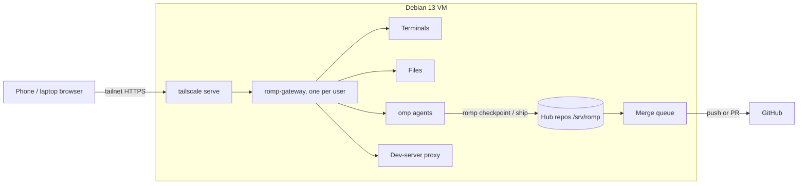

# ROMP

ROMP ("remote OMP") is a self-hosted web workspace for coding with AI agents from a phone, tablet or laptop. It runs inside a Linux VM on a home server and is reached over [Tailscale](https://tailscale.com). You prompt [OMP](https://github.com/can1357/oh-my-pi) coding agents; ROMP handles git for you: branches, commits, syncing with other people's work, merge conflicts and landing on `main`.



## Features

- **Window manager in the browser.** Each workspace runs in one of two modes, and you can switch at any time without losing windows. Scroll mode is a horizontal strip of columns (swipe between full-width columns on a phone). Tile mode splits the screen into panes with draggable dividers. The layout is saved on the server, so another device opens the same workspace.
- **Windows:**
  - terminal: persistent shell that survives disconnects and replays scrollback; extra-keys row on touch screens, with Select / Paste for copy and paste.
  - files: browse, create, rename, trash with undo.
  - editor: CodeMirror with autosave and conflict detection.
  - agent: OMP chat with streaming output, tool cards, steer / follow-up / stop, and answers to the agent's questions.
  - browser: your dev servers through `/proxy/<port>/`.
  - tasks: repos and tasks with Ship buttons.
- **Git you don't have to touch.** A task is a git worktree plus a branch plus an agent session:
  - The agent's git commands that change the repo are blocked.
  - After every agent run, ROMP commits, backs the work up, and merges in other people's latest changes using [mergiraf](https://mergiraf.org), which understands code syntax. When a real conflict remains, the agent is asked to resolve the markers.
  - **Ship** squashes the task and hands it to a merge queue. The queue rebases, runs your tests, lets a resolver agent fix leftover conflicts, then pushes to `main` (default) or opens a PR with auto-merge (per-repo setting).
- **Multi-user.** Each person has a Linux account and their own gateway. Everyone shares the hub repos and the merge queue, so two people can run agents on the same repository at once.
- **Installable** as a phone app (PWA), dark and light themes.

## Repository layout

| Path | What it is |
|---|---|
| `packages/protocol` | Wire types shared by the gateway and the web app |
| `packages/gateway` | Bun HTTP/WebSocket server: auth, terminals, files, OMP RPC bridge, proxy, layout state |
| `packages/core` | `romp` CLI and library: hub repos, tasks, checkpoint, ship, merge queue, OMP extension (`omp-extension/romp.ts`), resolver skill |
| `packages/web` | Svelte 5 + Vite web app |
| `deploy/` | `install.sh`, `add-user.sh`, systemd units, command wrappers, shared OMP settings (`omp-defaults/`) |
| `docs/deploy.md` | Detailed TrueNAS + Tailscale setup |
| `docs/design.md` | Web app design notes |

## Setup

You need a Debian 13 machine or VM, a Tailscale account, and an account with a model provider for OMP. [docs/deploy.md](docs/deploy.md) has the full walkthrough for TrueNAS SCALE: VM sizing, bridged networking, and running Tailscale alongside the host's.

1. **Install Tailscale in the VM.** Don't use `--accept-routes` if another node advertises your LAN.
   ```sh
   curl -fsSL https://tailscale.com/install.sh | sh
   sudo tailscale up --ssh
   ```
2. **Put this repository at `/opt/romp`**, either with `git clone` or by copying a tarball. Then install:
   ```sh
   sudo /opt/romp/deploy/install.sh
   ```
   This installs Bun, pnpm, tsgo, Node, git, mergiraf and gh, and creates the `romp` group and service user. It also builds the web app, puts `romp` and `romp-gateway` on PATH, initialises `/srv/romp`, and starts `romp-queue.service`. Re-run it after every update, or switch on automatic updates with `sudo systemctl enable --now romp-update.timer`: it pulls new commits from GitHub every 10 minutes and re-runs `install.sh` once no agent is mid-turn ([details](docs/deploy.md#updating)).
3. **Give the merge queue credentials** so it can push and resolve conflicts. Run these now, or later from **Settings → Server setup** in the web app (it opens a terminal running the same command; needs sudo):
   ```sh
   sudo -iu romp gh auth login     # or an SSH deploy key in /var/lib/romp/.ssh
   sudo -iu romp omp setup         # sign in to a provider and pick models
   ```
4. **Add each person:**
   ```sh
   #                              linux-user  tailscale-login  gateway-port  https-port
   sudo /opt/romp/deploy/add-user.sh you     you@github       7680          443
   sudo /opt/romp/deploy/add-user.sh alice   alice@github     7681          8443
   ```
   This creates the account, installs OMP, the ROMP extension and the shared OMP settings from `deploy/omp-defaults/`, writes `~/.config/romp/gateway.toml`, enables the `romp-gateway` user service, and runs `tailscale serve` (Tailscale serves HTTPS only on 443, 8443 and 10000). Someone without a Tailscale login yet gets `-` as their login and signs in over the LAN only; re-run the command with their login once they have one. The first ROMP terminal each person opens offers OMP's setup wizard to sign in to their own providers and pick models (`omp setup` reruns it). Each person also sets `git config --global user.name` / `user.email`. Shared settings, opting out (`romp omp-defaults off`) and what is never shared are described in [docs/deploy.md](docs/deploy.md#7-shared-omp-settings).
5. **Open** `https://<vm>.<tailnet>.ts.net/` (port 443) or `https://<vm>.<tailnet>.ts.net:8443/`, and use "Add to Home Screen" on a phone.
6. **Add a repository** from the Tasks window (**Add repo**), or on the VM:
   ```sh
   romp repo add git@github.com:you/project.git
   romp repo set project land=pr   # optional: land via PR + auto-merge instead of pushing to main
   ```
   Optionally commit a `.romp.toml` to the project with the commands for new worktrees and the merge queue:
   ```toml
   setup = "pnpm install --frozen-lockfile"
   test = "pnpm test"
   ```
7. **Optional: LAN access without Tailscale.** `sudo romp-lan enable` serves the same `ts.net` address on the VM's LAN IP through Caddy. Add a local DNS record on your router pointing that name at the VM, and have each person set a sign-in password with `romp-gateway passwd`. See [docs/deploy.md](docs/deploy.md#9-lan-access-without-tailscale-optional).

### Gateway configuration

`~/.config/romp/gateway.toml` (or `--config <path>`, or `$ROMP_GATEWAY_CONFIG`):

| Key | Default | Meaning |
|---|---|---|
| `listen` | `127.0.0.1:7680` | Must be loopback; Tailscale Serve forwards to it |
| `allow_logins` | | Tailscale logins allowed in (`Tailscale-User-Login` header) |
| `dev` | `false` | Disables auth; loopback only, for development |
| `lan_proxy_user` | | Linux account of the LAN reverse proxy (`caddy`, set by `romp-lan`); its connections must sign in with the password from `romp-gateway passwd` |
| `roots` | `["~"]` | Directories the files API, terminals and agents may use |
| `shell` | `/bin/bash` | Terminal shell |
| `omp` | `omp` | Path to the omp binary |
| `web_dir` | `packages/web/dist` | Built web app |
| `state_dir` | `~/.local/state/romp` | Saved layout and agent sessions |

The gateway trusts the Tailscale identity headers only on connections from sockets owned by root (tailscaled) or by the gateway's own user, so another local user can't impersonate someone. Connections from `lan_proxy_user` never get Tailscale identity; they need a session cookie from a password sign-in (argon2id hash in `~/.config/romp/password`, sessions in `state_dir/sessions.json`). Agents and terminals can only start in directories inside `roots`.

## Using it

- Open a window with **+** (phone) or **Alt O** (desktop). Other shortcuts: **Alt ←/→** move focus, **Alt T** switch scroll/tile, **Alt R** cycle column width, **Alt Enter** new terminal, **Alt W** close, **Alt 1…9** switch workspace. **Alt Shift /** lists all shortcuts.
- In **Tasks**, pick a repo and describe the work. ROMP creates a worktree and branch, starts an agent there, and opens its window. Keep prompting; changes are committed and synced after each agent run.
- Press **Ship** in Tasks, or type `/ship` in the agent, when the task is done. The task card follows it through queued → landing → landed. If tests fail, the log appears there and the agent is asked to fix it.
- From a terminal on the VM, `romp task list`, `romp status` and `romp --help` show the same state.

## Development

Requires pnpm (npm is not used) and Bun on Linux.

```sh
pnpm install
pnpm check    # tsc + svelte-check
pnpm test     # bun test (core, gateway) + vitest (web)
pnpm build    # web app → packages/web/dist
```

**On Windows**, the gateway needs Linux (PTYs, systemd). Run it in a Debian WSL distro:

```powershell
wsl -d Debian -u <you> -- bash /mnt/c/path/to/ROMP/scripts/wsl-dev-gateway.sh   # gateway on 127.0.0.1:7681, auth off
pnpm dev:web                                                                     # Vite on 5173, proxies to 7681
```

The script copies the checkout to `/opt/romp-dev` and starts a `romp-gateway-dev` user unit. Port 7681 is used because Windows reserves 7680 for Delivery Optimization; set `ROMP_GATEWAY` to point Vite elsewhere. WSL stops the distro when no `wsl.exe` process is attached, so keep one open (`wsl -d Debian -- sleep infinity`). In WSL shells, put `/usr/local/share/pnpm/bin` first on `PATH`; otherwise the Windows pnpm leaks in through interop and breaks installs.

## Status

The first milestone is complete and verified on Debian 13 (WSL): every part of the web app against a live gateway, live agent sessions, and two users shipping tasks through the merge queue. Not verified yet:

- `pr` landing mode (needs `gh` auth and a GitHub repo with auto-merge enabled).
- The queue's conflict-resolver agent, conflict messages injected into a live agent, and automatic re-ship after a failed landing (unit-tested, not run against a model).
- In `pr` mode, continuing a task after GitHub squash-merges it can conflict with its own landed change (push mode handles this).
- The terminal extra-keys row with a real phone's on-screen keyboard.
- Overview swipe-to-close and drag-to-reorder gestures.
- Stop sends `abort_and_restore_queue` (queued messages return to the composer); only plain `abort` was exercised live.
- The web bundle is a single 1.1 MB chunk (mostly CodeMirror languages); code-splitting is still to do.
- LAN access (`romp-lan`) on a real tailnet and router. Checked in WSL: password sign-in, sessions and lockout through a proxy account, Debian 13's Caddy accepting the generated config and stripping spoofed `Tailscale-User-*` headers, and parsing of `tailscale serve status --json`. Not checked: `tailscale cert` and `tailscale serve` themselves.
- `romp-update` on the TrueNAS VM. Checked in WSL against a local upstream: applying, waiting for busy agents or a landing, and refusing local commits.
