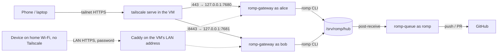

# Deploying ROMP on TrueNAS SCALE

ROMP runs inside one Debian 13 VM. Every person gets a Linux account and their own gateway; the merge queue runs once for everyone.



The dotted LAN path is optional (section 9).

## 1. Create the VM (TrueNAS 25.10)

1. Download the Debian 13 netinst ISO and upload it to a dataset.
2. **Virtual Machines → Add**: Linux, 4 to 8 vCPUs, 16 GiB RAM (agents mostly wait on APIs; builds and dev servers are what use CPU), a 64 to 128 GiB zvol on an SSD pool, VirtIO disk and NIC.
3. Attach the NIC to a **bridge** (`br0`) rather than the raw interface if the VM must reach NAS shares; a VM attached directly to the host NIC cannot talk to the host.
4. Install Debian: SSH server + standard utilities only, no desktop.
5. After the first boot, install the tools the next steps need before `install.sh` runs, plus the guest agent and automatic security updates:

   ```sh
   sudo apt install curl git qemu-guest-agent unattended-upgrades
   ```

## 2. Tailscale inside the VM

The VM joins your tailnet as its own node, independent of the TrueNAS host (which may run Tailscale too).

```sh
curl -fsSL https://tailscale.com/install.sh | sh
sudo tailscale up --ssh --advertise-tags=tag:devbox
```

- Do **not** pass `--accept-routes` if the TrueNAS host advertises your LAN subnet; the VM would route its own LAN through Tailscale.
- Disable key expiry for the VM in the admin console.
- To give a second person access, share only this VM node with them (sharing is per device, so they never see the NAS).

## 3. Copy ROMP into the VM

Run this step from your own account, not a root shell. The checkout at `/opt/romp` should belong to you, so `git pull` works later without `sudo`. The path must be lowercase `/opt/romp`, because the scripts and services look for exactly that path and Linux paths are case-sensitive.

Either push the repo to a private GitHub repo and clone it:

```sh
sudo mkdir -p /opt/romp
sudo chown "$USER": /opt/romp
git clone https://github.com/<owner>/ROMP.git /opt/romp
```

Or copy it over Tailscale (PowerShell shown; any shell with `tar` and `scp` works the same):

```powershell
# from the folder that contains ROMP
tar --exclude=node_modules --exclude=dist -czf romp.tgz ROMP
scp romp.tgz <vm-name>:/tmp/
```
```sh
sudo mkdir -p /opt/romp && sudo tar -xzf /tmp/romp.tgz -C /opt/romp --strip-components=1
sudo chown -R "$USER": /opt/romp
```

## 4. Install

```sh
sudo /opt/romp/deploy/install.sh
```

This installs Bun, pnpm, tsgo, mergiraf, gh and Node, creates the `romp` group and service user, builds the web app, initialises `/srv/romp`, and starts `romp-queue.service`. It also installs `romp-update.timer`, which can keep the VM up to date with GitHub; it is off until you switch it on (see [Updating](#updating)).

Give the queue its credentials once. It pushes to GitHub and runs an agent to resolve merge conflicts. These belong to the `romp` service user, which only the queue runs as; they are not shared with anyone's account, and each person signs in separately (step 5).

```sh
sudo -iu romp gh auth login
sudo -iu romp omp setup  # sign in to a provider and pick models
```

When `gh auth login` asks for your preferred protocol for Git operations, choose HTTPS, and answer yes to authenticating Git with your GitHub credentials. gh stores a token and git uses it for every push, so there is no SSH key to create or host key to accept. The queue pushes to the exact URL a repo was added with (step 7), so add repos with `https://` URLs to match.

## 5. Add people

Everyone gets their own gateway, including you. Run `add-user.sh` once per person. If the Linux account already exists, the script uses it instead of creating one.

```sh
sudo /opt/romp/deploy/add-user.sh alice alice@github 7680 443
sudo /opt/romp/deploy/add-user.sh bob bob@example.com 7681 8443
```

The arguments, in order:

1. The Linux account name.
2. The person's Tailscale login. The gateway rejects requests from any other login, and the match must be exact. Once the person's phone or laptop has joined the tailnet, `tailscale status` on the VM shows the owner login next to each device, for example `alice@github` or an email address. The admin console lists it under Users too. Pass `-` for someone who doesn't have one yet (see below).
3. The gateway port. The gateway listens on it inside the VM only. Give each person a different one.
4. The HTTPS port the person's browser connects to. Tailscale serves HTTPS only on 443, 8443 and 10000, so one VM fits three people.

If `tailscale serve` says HTTPS is not enabled for your tailnet, open the link it prints, turn HTTPS on, and run `add-user.sh` again. Running it twice is safe.

Each person then sets up their own account from **Settings** in the web app. None of it needs sudo, and none of it is shared with other people:

- **Git identity**: the name and email on their commits (`git config --global user.name` / `user.email`).
- **GitHub**: runs `gh auth login` in a terminal. Only needed to add private repos (section 7).
- **AI providers**: runs `omp setup` in a terminal to sign in to providers and pick models.

An admin can do the same from a shell by putting `sudo -iu alice` in front of each command.

### Adding someone before they have Tailscale

Pass `-` as the login to set the person up now and give them Tailscale access later:

```sh
sudo /opt/romp/deploy/add-user.sh carol - 7682 10000
```

Their gateway refuses every Tailscale request (the browser shows `No Tailscale login is allowed on this gateway yet`), so until they have a login they can only sign in over the LAN with a password. That needs LAN access turned on (section 9) and a password set with `sudo -iu carol romp-gateway passwd`. Without LAN access, nobody can open their gateway yet; the script warns about this.

Once they have joined the tailnet (invite them from the Tailscale admin console, or share the VM with them), run the script again with their login and the same other arguments:

```sh
sudo /opt/romp/deploy/add-user.sh carol carol@github 7682 10000
```

This adds the login to `allow_logins` in their existing `~/.config/romp/gateway.toml` and restarts their gateway. The LAN password keeps working. Run it again the same way to allow a second login. The script only adds logins: to remove one, edit `allow_logins` by hand and run `systemctl --user restart romp-gateway` as them.

## 6. Open ROMP on a phone

1. Install the Tailscale app on the phone, sign in with the same account as the login passed to `add-user.sh`, and switch the VPN on. ROMP is only reachable from devices in the tailnet.
2. Get the address on the VM with `tailscale serve status`. It prints one URL per person, such as `https://debian.tail1234.ts.net/` for port 443 and `https://debian.tail1234.ts.net:8443/` for 8443. Open it in the phone's browser. The first load can take a few seconds while Tailscale fetches the HTTPS certificate.
3. Install it as an app. In Safari, tap Share, then Add to Home Screen. In Chrome on Android, open the ⋮ menu and choose Add to Home screen (or Install app). iOS reads the app's status-bar settings only when it is added, so after a ROMP update that changes them, remove the Home Screen icon and add it again.
4. The first terminal opened in ROMP offers OMP's setup wizard, which signs in to AI providers (Anthropic, OpenRouter, ...) and picks models. **Settings → Set up OMP**, or `omp setup` in a terminal, reruns it at any time.

A laptop works the same way: join the tailnet and open the same URL in any browser.

## 7. Add repositories

In the Tasks pane choose **Add repo** and paste the clone URL, or on the VM:

```sh
romp repo add https://github.com/<owner>/project.git
romp repo set project land=pr        # optional: land through PRs with auto-merge instead of pushing to main
```

Whoever adds a repo makes the first clone from GitHub as their own Linux user, so for a private repo they need their own GitHub sign-in first: **Settings → Set up GitHub** in the web app, or `gh auth login` in a terminal (HTTPS, as in step 4). After that, people work through the copy on the VM and only the queue talks to GitHub.

Commit a `.romp.toml` to the project to tell ROMP how to install dependencies in a new worktree and how to test before landing:

```toml
setup = "pnpm install --frozen-lockfile"
test = "pnpm test"
```

## 8. Shared OMP settings

`deploy/omp-defaults/` is laid out like `~/.omp/agent/`. Put the OMP files everyone should start with there (`config.yml`, `RULES.md`, `skills/`, `commands/`, `lsp.json`, ...). `add-user.sh` copies them to a new user, and every run of `install.sh` brings each user (and the `romp` service user) up to date. The VM has no display or desktop browser, so leave out anything that needs one (browser MCP servers, sign-in windows). Users are never overwritten:

- `config.yml` and other YAML/JSON files merge per setting. A setting follows the shipped value until the user changes it; from then on their value is kept.
- Other files are replaced only while the user hasn't edited them. A file the user deleted is not restored, and a file dropped from `omp-defaults/` is removed only if the user never edited it.
- Model choices are never copied: `models.yml` and the `config.yml` model settings (`modelRoles`, `modelPresets`, `modelTags`, `modelProviderOrder`, `modelRoleStorage`, `cycleOrder`, `enabledModels`, `disabledProviders`, `retry.fallbackChains`) stay with each user, as do OMP's `setupVersion` and `dev.autoqaConsent`. `task.agentModelOverrides` entries are shared only when they name a role (`scout: "@smol"`), so each agent runs on whatever model that user gave the role. You can copy your own `config.yml` in as is.
- Credentials, history and sessions (`*.db`, `sessions/`) are never copied, even if they end up in the folder.

Each user controls this with `romp`:

```sh
romp omp-defaults          # what the next update would change
romp omp-defaults sync     # update now
romp omp-defaults off      # stop receiving updates (files already copied stay)
romp omp-defaults on       # resume, and update now
```

### Designer (opt-in)

The shared settings include a `designer` agent, a `/design` command, a design gate that nudges the agent to consult the designer before UI work, and a Designer advisor. All of it is off by default (`task.disabledAgents: [designer]`, and the advisor is `enabled: false` in `WATCHDOG.yml`). To opt in:

1. In `omp`, open `/models` and assign a model to the `designer` role.
2. `omp config set task.disabledAgents '[]'` enables the agent, `/design` and the design gate.
3. Optional, for the advisor that reviews every turn: set `enabled: true` under `Designer` in `~/.omp/agent/WATCHDOG.yml` and run `omp config set advisor.enabled true`. It reviews with the designer model on every turn, which costs tokens.

These changes are the user's own values, so later updates leave them in place.

## 9. LAN access without Tailscale (optional)

At home, a device can reach ROMP without the Tailscale app. It uses the same address as over Tailscale (`https://<vm>.<tailnet>.ts.net/`), so the Home Screen app works in both places. Devices that do run Tailscale need none of this: Tailscale already connects directly over the LAN when both ends are at home.

How it works: Caddy listens on the VM's LAN address, on the same HTTPS ports as `tailscale serve`, and uses the certificate from `tailscale cert`. A DNS record on your router sends the `ts.net` name to that LAN address. LAN connections carry no Tailscale identity, so each person signs in with a password. Over Tailscale nothing changes and no password is asked.

1. Give the VM a fixed LAN address: a DHCP reservation on the router is easiest.
2. Turn LAN access on. It installs Caddy, fetches the certificate and starts a daily renewal timer (`romp-lan.timer`). It detects the LAN address; if it picks the wrong one, pass it explicitly:

   ```sh
   sudo romp-lan enable              # or: sudo romp-lan enable 192.168.1.50
   ```

   Turning it on restarts every gateway once, which closes open terminals and stops running agents.
3. In the router's local DNS (Pi-hole, AdGuard Home and most routers call it "local DNS records" or "DNS overrides"), point the name printed in the previous step, such as `debian.tail1234.ts.net`, at the VM's LAN address.
4. Each person sets the password they will sign in with on the LAN. In a ROMP terminal, or as an admin with `sudo -iu alice` in front:

   ```sh
   romp-gateway passwd
   ```

On the device, switch Tailscale off and open the usual address. ROMP shows a sign-in screen; after signing in, the device stays signed in until it has been unused for 30 days. Changing the password with `romp-gateway passwd` signs out every LAN device. After five wrong passwords, sign-in pauses for 30 seconds, and the pause doubles with each further miss, up to 15 minutes.

`add-user.sh` and `install.sh` keep Caddy in line with `tailscale serve`, so new people get LAN access automatically (they still set a password). Someone without a Tailscale login can use ROMP this way until they get one (section 5). To turn LAN access off:

```sh
sudo romp-lan disable
```

Then remove the DNS record, so devices go back to using Tailscale.

Some devices bypass the router's DNS and never see the record: Android's Private DNS (set it to Automatic or Off), Chrome's and Firefox's secure DNS, and VPN apps. On those, the name keeps pointing at the Tailscale address, which only answers while Tailscale is on.

## Updating

```sh
cd /opt/romp && git pull        # or copy a new tarball
sudo /opt/romp/deploy/install.sh    # also updates everyone's shared OMP settings
```

### Automatic updates (off by default)

To have the VM do this on its own, switch on the update timer once:

```sh
sudo systemctl enable --now romp-update.timer
```

It checks GitHub every 10 minutes. When the checkout's branch has new commits, it fast-forwards `/opt/romp` and runs `install.sh`. Fetching a public repo needs no credentials and costs nothing. `install.sh` never switches the timer on or off, so your choice survives updates.

Restarting a gateway stops agents that are in the middle of a turn and closes open terminals. So an update waits while any agent is working or the merge queue is landing a task, and tries again 10 minutes later. Agents resume their conversations after the restart; terminals start fresh. Whatever reaches the branch on GitHub runs as root on the VM, with no one checking it first.

- See what it did: `journalctl -u romp-update` (for example, `update to 1a2b3c4 waits: agents are running for alice`).
- Check now instead of waiting: `sudo romp-update` (works with the timer off too).
- Turn it off again: `sudo systemctl disable --now romp-update.timer`.
- It never overwrites work on the VM: if `/opt/romp` has commits that are not on GitHub, or uncommitted changes in the way, it logs the reason and does nothing.
- If `install.sh` fails (for example, a build error), that commit is not retried. Fix the problem and push a new commit, or run `sudo /opt/romp/deploy/install.sh` yourself.

## Troubleshooting

These are the errors people new to Linux tend to hit during setup. The headings quote the error message, so you can search this page for what your terminal printed.

First, check who you are. The prompt ends in `$` for a normal account (`alice@debian:/opt/romp$`) and `#` for root (`root@debian:/opt/romp#`). This guide assumes your own account, with `sudo` in front of commands that need root. In a root shell `sudo` does nothing useful, so leave it off.

### `Permission denied` when running a script

Linux runs a file as a program only if its execute bit is set. Git stores that bit, and the scripts in `deploy/` have it, but a copy can lose it. `sudo ./deploy/install.sh` then fails with `command not found` for the same reason. Run the script through bash, or set the bit back:

```sh
sudo bash /opt/romp/deploy/install.sh
chmod +x /opt/romp/deploy/*.sh
```

### `ROMP checkout not found at /opt/romp (set ROMP_SRC)`

The repo is somewhere other than `/opt/romp`. Often it is `/opt/ROMP`, because `git clone` names the folder after the repo and Linux treats `ROMP` and `romp` as different names. Rename it:

```sh
sudo mv /opt/ROMP /opt/romp
```

Setting `ROMP_SRC` gets `install.sh` past this check, but the `romp` and `romp-gateway` commands and the systemd services still look in `/opt/romp`, so renaming is the real fix.

### `detected dubious ownership` or `Permission denied` on `.git/...` during `git pull`

Root owns the checkout, usually because it was cloned or extracted in a root shell or with `sudo`. Git suggests `git config --global --add safe.directory /opt/romp`, but that only silences the ownership warning. It does not let you write to the folder, so the next `git pull` fails with `cannot open '.git/FETCH_HEAD': Permission denied`. Avoid `sudo git pull` as well, because it creates more root-owned files inside `.git`. Give the folder to your account instead:

```sh
sudo chown -R "$USER": /opt/romp
```

`chown` changes who owns files. `-R` applies it to everything inside the folder. The `user:group` argument sets the owner and the group together. `"$USER":`, with nothing after the colon, means your account and your account's default group. Your shell fills in `$USER` before `sudo` runs, so it is your name, not root's.

`install.sh` later moves the files into the `romp` group so the merge queue's service user can read them. It never changes the owner, so `git pull` keeps working for you. The `romp` group only exists after `install.sh` has got that far, which is why the command above doesn't name it.

If you added a `safe.directory` entry, remove it once the chown is done:

```sh
git config --global --unset safe.directory /opt/romp
```

### `Your local changes to the following files would be overwritten by merge`

A file in the checkout differs from the last commit, for example after editing a script on the VM or running `chmod` on it. `git status` lists the files and `git diff` shows what changed. If you don't need the change, discard it and pull again:

```sh
git restore deploy/install.sh
git pull
```

### `omp: command not found`

OMP lives in each user's `~/.bun/bin`, and `/etc/profile.d/romp-setup.sh` (installed by `install.sh`) adds that folder to `PATH` for login shells. A shell opened before `install.sh` last ran doesn't have it yet, so log out and back in. To run OMP for another user before then, give the full path:

```sh
sudo -iu romp /var/lib/romp/.bun/bin/omp setup
```

Don't write `~/.bun/bin/omp` there. Your own shell expands `~` to your home folder before `sudo` runs, so it would point at the wrong user's files.

### Errors when opening ROMP in the browser

| Message | Cause | Fix |
|---|---|---|
| `No Tailscale identity: open the gateway through tailscale serve` | The page was opened on the gateway port directly, such as `127.0.0.1:7680` | Use the `https://...ts.net` address from `tailscale serve status` |
| `<login> is not allowed on this gateway` | The login given to `add-user.sh` doesn't match the one Tailscale reports | Run `add-user.sh` again with the right login (it adds it), or fix `allow_logins` in that user's `~/.config/romp/gateway.toml` and run `systemctl --user restart romp-gateway` as them |
| `No Tailscale login is allowed on this gateway yet` | The person was added with `-` as their login | Run `add-user.sh` again with their Tailscale login |
| The page never loads | The device isn't on the tailnet, or (on the LAN) the DNS record is missing or bypassed | Switch on the VPN in the Tailscale app, or check section 9 |
| `Sign-in isn't enabled on this gateway` (LAN) | That person has not set a LAN password | Run `romp-gateway passwd` as them |
| `Too many attempts. Try again in N s.` (LAN) | Five or more wrong passwords in a row | Wait, then sign in; over Tailscale there is no lockout |

Re-running `add-user.sh` adds a missing login but never removes one: take a wrong login out of `allow_logins` by hand.

### `Permission denied` on `/srv/romp/hub/.tmp-...` when adding a repo

The repo is cloned by your own gateway, which has to be in the `romp` group to write to `/srv/romp/hub`. `add-user.sh` adds the account to the group, but a process started before that keeps its old groups. The gateway is started by your systemd user manager, which was probably already running because you were logged in. Re-run `add-user.sh` for the account (it restarts the user manager when it lacks the group), or restart it yourself:

```sh
sudo systemctl restart "user@$(id -u <linux-user>).service"
```

For `romp repo add` in a terminal, log out and back in first. Cloning a private repo also needs that person's own `gh auth login` (section 7); the `romp` user's login is only used by the merge queue.

### `refusing to allow an OAuth App to create or update workflow`

The queue tried to push a change to `.github/workflows/`, and its GitHub token lacks the `workflow` scope. Add the scope:

```sh
sudo -iu romp gh auth refresh -s workflow
```
