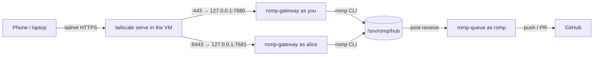

# Deploying ROMP on TrueNAS SCALE

ROMP runs inside one Debian 13 VM. Every person gets a Linux account and their own gateway; the merge queue runs once for everyone.



## 1. Create the VM (TrueNAS 25.10)

1. Download the Debian 13 netinst ISO and upload it to a dataset.
2. **Virtual Machines → Add**: Linux, 4 to 8 vCPUs, 16 GiB RAM (agents mostly wait on APIs; builds and dev servers are what use CPU), a 64 to 128 GiB zvol on an SSD pool, VirtIO disk and NIC.
3. Attach the NIC to a **bridge** (`br0`) rather than the raw interface if the VM must reach NAS shares; a VM attached directly to the host NIC cannot talk to the host.
4. Install Debian: SSH server + standard utilities only, no desktop.

## 2. Tailscale inside the VM

Your TrueNAS host already runs Tailscale; the VM becomes a second, independent node.

```sh
curl -fsSL https://tailscale.com/install.sh | sh
sudo tailscale up --ssh --advertise-tags=tag:devbox
```

- Do **not** pass `--accept-routes` if the TrueNAS host advertises your LAN subnet; the VM would route its own LAN through Tailscale.
- Disable key expiry for the VM in the admin console.
- To give a second person access, share only this VM node with them (sharing is per device, so they never see the NAS).

## 3. Copy ROMP into the VM

From the Windows machine, either push the repo to a private GitHub repo and `git clone` it to `/opt/romp`, or copy it over Tailscale:

```powershell
# from the folder that contains ROMP
tar --exclude=node_modules --exclude=dist -czf romp.tgz ROMP
scp romp.tgz <vm-name>:/tmp/
```
```sh
sudo mkdir -p /opt/romp && sudo tar -xzf /tmp/romp.tgz -C /opt/romp --strip-components=1
```

## 4. Install

```sh
sudo /opt/romp/deploy/install.sh
```

This installs Bun, pnpm, mergiraf, gh and Node, creates the `romp` group and service user, builds the web app, initialises `/srv/romp`, and starts `romp-queue.service`.

Give the queue its credentials once (it pushes to GitHub and runs the conflict-resolver agent):

```sh
sudo -iu romp gh auth login
sudo -iu romp omp setup  # sign in to a provider and pick models
```

## 5. Add people

```sh
sudo /opt/romp/deploy/add-user.sh you you@github 7680 443
sudo /opt/romp/deploy/add-user.sh alice alice@github 7681 8443
```

The second argument is the person's Tailscale login (shown in the Tailscale admin console under Users). The first terminal each person opens in ROMP offers OMP's setup wizard to sign in to their providers (Anthropic, OpenRouter, ...) and pick models; they can rerun it any time with `omp setup`. Each person also sets a git identity.

Open `https://<vm-name>.<tailnet>.ts.net/` (you) or `https://<vm-name>.<tailnet>.ts.net:8443/` (alice), then "Add to Home Screen" to install it as an app.

## 6. Add repositories

In the Tasks pane choose **Add repo** and paste the clone URL, or on the VM:

```sh
romp repo add git@github.com:you/project.git
romp repo set project land=pr        # optional: land through PRs with auto-merge instead of pushing to main
```

Commit a `.romp.toml` to the project to tell ROMP how to install dependencies in a new worktree and how to test before landing:

```toml
setup = "pnpm install --frozen-lockfile"
test = "pnpm test"
```

## 7. Shared OMP settings

`deploy/omp-defaults/` is laid out like `~/.omp/agent/`. Put the OMP files everyone should start with there (`config.yml`, `RULES.md`, `skills/`, `commands/`, `lsp.json`, `mcp.json`, ...). `add-user.sh` copies them to a new user, and every run of `install.sh` brings each user (and the `romp` service user) up to date. Users are never overwritten:

- `config.yml` and other YAML/JSON files merge per setting. A setting follows the shipped value until the user changes it; from then on their value is kept.
- Other files are replaced only while the user hasn't edited them. A file the user deleted is not restored, and a file dropped from `omp-defaults/` is removed only if the user never edited it.
- Model choices are never copied: `models.yml` and the `config.yml` model settings (`modelRoles`, `modelPresets`, `modelTags`, `modelProviderOrder`, `modelRoleStorage`, `cycleOrder`, `enabledModels`, `disabledProviders`, `retry.fallbackChains`, `task.agentModelOverrides`) stay with each user, as does OMP's `setupVersion`. You can copy your own `config.yml` in as is.
- Credentials, history and sessions (`*.db`, `sessions/`) are never copied, even if they end up in the folder.

Each user controls this with `romp`:

```sh
romp omp-defaults          # what the next update would change
romp omp-defaults sync     # update now
romp omp-defaults off      # stop receiving updates (files already copied stay)
romp omp-defaults on       # resume, and update now
```

## Updating

```sh
cd /opt/romp && git pull        # or copy a new tarball
sudo /opt/romp/deploy/install.sh    # also updates everyone's shared OMP settings
```
