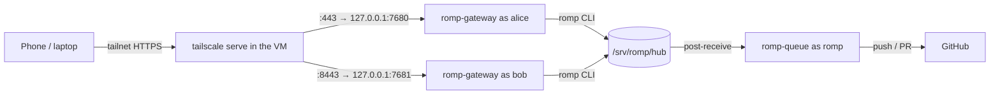

# Deploying ROMP on TrueNAS SCALE

ROMP runs inside one Debian 13 VM. Every person gets a Linux account and their own gateway; the merge queue runs once for everyone.



## 1. Create the VM (TrueNAS 25.10)

1. Download the Debian 13 netinst ISO and upload it to a dataset.
2. **Virtual Machines → Add**: Linux, 4 to 8 vCPUs, 16 GiB RAM (agents mostly wait on APIs; builds and dev servers are what use CPU), a 64 to 128 GiB zvol on an SSD pool, VirtIO disk and NIC.
3. Attach the NIC to a **bridge** (`br0`) rather than the raw interface if the VM must reach NAS shares; a VM attached directly to the host NIC cannot talk to the host.
4. Install Debian: SSH server + standard utilities only, no desktop.
5. After the first boot, install the tools the next steps need before `install.sh` runs, plus the guest agent and automatic security updates:

   ```sh
   sudo apt install curl git qemu-guest-agent unattended-upgrades
   ```

## 2. Tailscale inside the VM

The VM joins your tailnet as its own node, independent of the TrueNAS host (which may run Tailscale too).

```sh
curl -fsSL https://tailscale.com/install.sh | sh
sudo tailscale up --ssh --advertise-tags=tag:devbox
```

- Do **not** pass `--accept-routes` if the TrueNAS host advertises your LAN subnet; the VM would route its own LAN through Tailscale.
- Disable key expiry for the VM in the admin console.
- To give a second person access, share only this VM node with them (sharing is per device, so they never see the NAS).

## 3. Copy ROMP into the VM

Run this step from your own account, not a root shell. The checkout at `/opt/romp` should belong to you, so `git pull` works later without `sudo`. The path must be lowercase `/opt/romp`, because the scripts and services look for exactly that path and Linux paths are case-sensitive.

Either push the repo to a private GitHub repo and clone it:

```sh
sudo mkdir -p /opt/romp
sudo chown "$USER": /opt/romp
git clone https://github.com/<owner>/ROMP.git /opt/romp
```

Or copy it over Tailscale (PowerShell shown; any shell with `tar` and `scp` works the same):

```powershell
# from the folder that contains ROMP
tar --exclude=node_modules --exclude=dist -czf romp.tgz ROMP
scp romp.tgz <vm-name>:/tmp/
```
```sh
sudo mkdir -p /opt/romp && sudo tar -xzf /tmp/romp.tgz -C /opt/romp --strip-components=1
sudo chown -R "$USER": /opt/romp
```

## 4. Install

```sh
sudo /opt/romp/deploy/install.sh
```

This installs Bun, pnpm, tsgo, mergiraf, gh and Node, creates the `romp` group and service user, builds the web app, initialises `/srv/romp`, and starts `romp-queue.service`.

Give the queue its credentials once (it pushes to GitHub and runs the conflict-resolver agent):

```sh
sudo -iu romp gh auth login
sudo -iu romp omp setup  # sign in to a provider and pick models
```

## 5. Add people

```sh
sudo /opt/romp/deploy/add-user.sh alice alice@example.com 7680 443
sudo /opt/romp/deploy/add-user.sh bob bob@example.com 7681 8443
```

The second argument is the person's Tailscale login (shown in the Tailscale admin console under Users). The first terminal each person opens in ROMP offers OMP's setup wizard to sign in to their providers (Anthropic, OpenRouter, ...) and pick models; they can rerun it any time with `omp setup`. Each person also sets a git identity.

Open `https://<vm-name>.<tailnet>.ts.net/` (alice) or `https://<vm-name>.<tailnet>.ts.net:8443/` (bob), then "Add to Home Screen" to install it as an app.

## 6. Add repositories

In the Tasks pane choose **Add repo** and paste the clone URL, or on the VM:

```sh
romp repo add git@github.com:<owner>/project.git
romp repo set project land=pr        # optional: land through PRs with auto-merge instead of pushing to main
```

Commit a `.romp.toml` to the project to tell ROMP how to install dependencies in a new worktree and how to test before landing:

```toml
setup = "pnpm install --frozen-lockfile"
test = "pnpm test"
```

## 7. Shared OMP settings

`deploy/omp-defaults/` is laid out like `~/.omp/agent/`. Put the OMP files everyone should start with there (`config.yml`, `RULES.md`, `skills/`, `commands/`, `lsp.json`, ...). `add-user.sh` copies them to a new user, and every run of `install.sh` brings each user (and the `romp` service user) up to date. The VM has no display or desktop browser, so leave out anything that needs one (browser MCP servers, sign-in windows). Users are never overwritten:

- `config.yml` and other YAML/JSON files merge per setting. A setting follows the shipped value until the user changes it; from then on their value is kept.
- Other files are replaced only while the user hasn't edited them. A file the user deleted is not restored, and a file dropped from `omp-defaults/` is removed only if the user never edited it.
- Model choices are never copied: `models.yml` and the `config.yml` model settings (`modelRoles`, `modelPresets`, `modelTags`, `modelProviderOrder`, `modelRoleStorage`, `cycleOrder`, `enabledModels`, `disabledProviders`, `retry.fallbackChains`) stay with each user, as do OMP's `setupVersion` and `dev.autoqaConsent`. `task.agentModelOverrides` entries are shared only when they name a role (`scout: "@smol"`), so each agent runs on whatever model that user gave the role. You can copy your own `config.yml` in as is.
- Credentials, history and sessions (`*.db`, `sessions/`) are never copied, even if they end up in the folder.

Each user controls this with `romp`:

```sh
romp omp-defaults          # what the next update would change
romp omp-defaults sync     # update now
romp omp-defaults off      # stop receiving updates (files already copied stay)
romp omp-defaults on       # resume, and update now
```

### Designer (opt-in)

The shared settings include a `designer` agent, a `/design` command, a design gate that nudges the agent to consult the designer before UI work, and a Designer advisor. All of it is off by default (`task.disabledAgents: [designer]`, and the advisor is `enabled: false` in `WATCHDOG.yml`). To opt in:

1. In `omp`, open `/models` and assign a model to the `designer` role.
2. `omp config set task.disabledAgents '[]'` enables the agent, `/design` and the design gate.
3. Optional, for the advisor that reviews every turn: set `enabled: true` under `Designer` in `~/.omp/agent/WATCHDOG.yml` and run `omp config set advisor.enabled true`. It reviews with the designer model on every turn, which costs tokens.

These changes are the user's own values, so later updates leave them in place.

## Updating

```sh
cd /opt/romp && git pull        # or copy a new tarball
sudo /opt/romp/deploy/install.sh    # also updates everyone's shared OMP settings
```

## Troubleshooting

These are the errors people new to Linux tend to hit during setup. The headings quote the error message, so you can search this page for what your terminal printed.

First, check who you are. The prompt ends in `$` for a normal account (`alice@debian:/opt/romp$`) and `#` for root (`root@debian:/opt/romp#`). This guide assumes your own account, with `sudo` in front of commands that need root. In a root shell `sudo` does nothing useful, so leave it off.

### `Permission denied` when running a script

Linux runs a file as a program only if its execute bit is set. Git stores that bit, and the scripts in `deploy/` have it, but a copy can lose it. `sudo ./deploy/install.sh` then fails with `command not found` for the same reason. Run the script through bash, or set the bit back:

```sh
sudo bash /opt/romp/deploy/install.sh
chmod +x /opt/romp/deploy/*.sh
```

### `ROMP checkout not found at /opt/romp (set ROMP_SRC)`

The repo is somewhere other than `/opt/romp`. Often it is `/opt/ROMP`, because `git clone` names the folder after the repo and Linux treats `ROMP` and `romp` as different names. Rename it:

```sh
sudo mv /opt/ROMP /opt/romp
```

Setting `ROMP_SRC` gets `install.sh` past this check, but the `romp` and `romp-gateway` commands and the systemd services still look in `/opt/romp`, so renaming is the real fix.

### `detected dubious ownership` or `Permission denied` on `.git/...` during `git pull`

Root owns the checkout, usually because it was cloned or extracted in a root shell or with `sudo`. Git suggests `git config --global --add safe.directory /opt/romp`, but that only silences the ownership warning. It does not let you write to the folder, so the next `git pull` fails with `cannot open '.git/FETCH_HEAD': Permission denied`. Avoid `sudo git pull` as well, because it creates more root-owned files inside `.git`. Give the folder to your account instead:

```sh
sudo chown -R "$USER": /opt/romp
```

`chown` changes who owns files. `-R` applies it to everything inside the folder. The `user:group` argument sets the owner and the group together. `"$USER":`, with nothing after the colon, means your account and your account's default group. Your shell fills in `$USER` before `sudo` runs, so it is your name, not root's.

`install.sh` later moves the files into the `romp` group so the merge queue's service user can read them. It never changes the owner, so `git pull` keeps working for you. The `romp` group only exists after `install.sh` has got that far, which is why the command above doesn't name it.

If you added a `safe.directory` entry, remove it once the chown is done:

```sh
git config --global --unset safe.directory /opt/romp
```

### `Your local changes to the following files would be overwritten by merge`

A file in the checkout differs from the last commit, for example after editing a script on the VM or running `chmod` on it. `git status` lists the files and `git diff` shows what changed. If you don't need the change, discard it and pull again:

```sh
git restore deploy/install.sh
git pull
```
